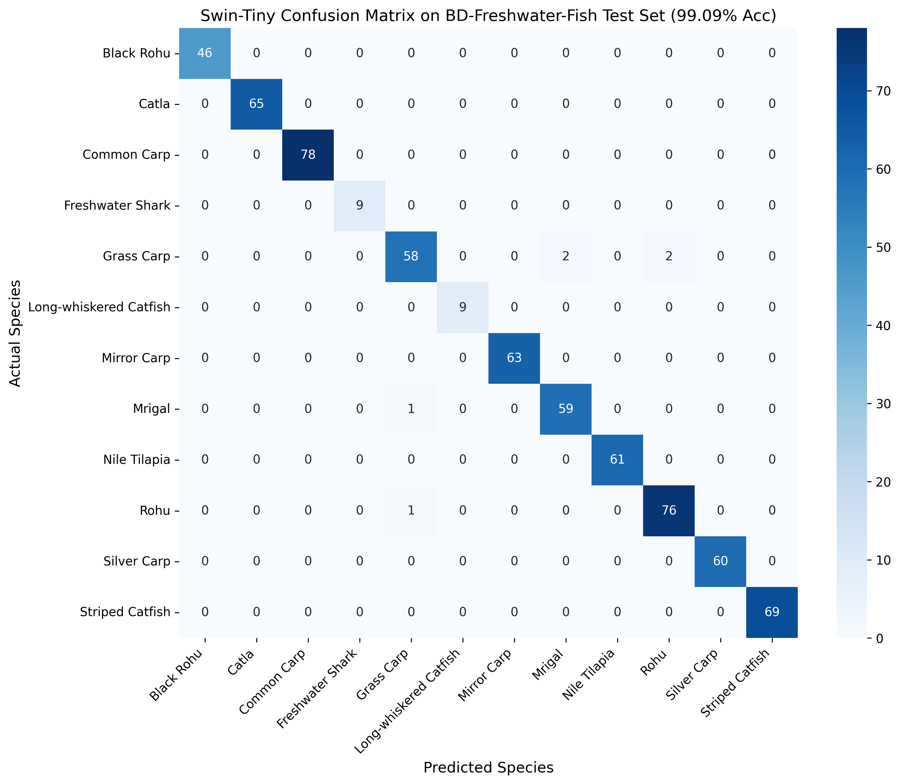

# Bangladesh Freshwater Fish Classification (Swin Transformer)

Fine-tuned **Swin-Tiny** (`microsoft/swin-tiny-patch4-window7-224`) to classify 12 native freshwater fish species of Bangladesh, using inverse-frequency class-weighted Cross-Entropy loss to handle severe class imbalance (60 images in minority classes vs. ~520 in majority classes).

## Results on Untouched Test Split (659 Images)
* **Test Accuracy:** 99.09% (653 / 659 correct)
* **Macro F1-Score:** 0.9922
* **Minority Class Performance:** 1.0000 F1 on both *Freshwater Shark* and *Long-whiskered Catfish*

## Confusion Matrix

## Notebook Overview
1. **Preprocessing:** Automated cleanup and one-time resolution standardization (max 512px) to eliminate 108MP JPEG decoding bottlenecks.
2. **Stratified Split & Augmentation:** 70% Train (3,072) / 15% Val (658) / 15% Test (659) with random resized crops, horizontal flips, and color jitter.
3. **Training:** 10 epochs on Tesla T4 GPU (`lr=5e-5`, `fp16=True`, class-weighted loss), peaking at Epoch 7.
4. **Evaluation & Inference:** Full per-species precision/recall report, confusion matrix, and single-image Hugging Face `pipeline` inference.
